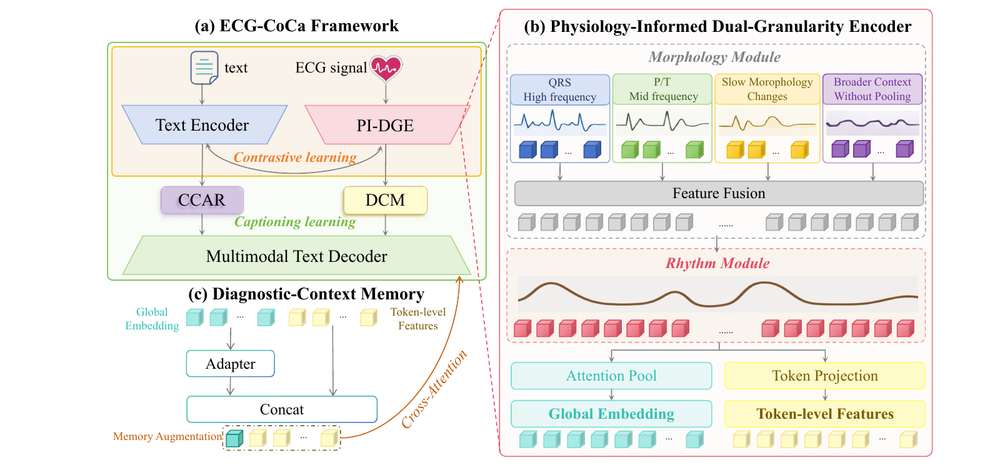

# ECG-CoCa: Physiology-Informed Contrastive and Generative Framework for ECG Interpretation

<p align="center">
  
</p>

<p align="center"><em><b>Figure 1. Overview of ECG-CoCa.</b> The framework couples physiology-informed dual-granularity ECG encoding with contrastive alignment and clinically grounded report generation. PI-DGE models complementary morphology- and rhythm-level representations, while CCAR addresses long-tail clinical concepts and DCM injects global diagnostic context into the multimodal decoder.</em></p>

ECG-CoCa is a unified contrastive-generative framework for direct interpretation of raw 12-lead ECG signals. It introduces a **Physiology-Informed Dual-Granularity Encoder (PI-DGE)** to jointly capture fine-grained waveform morphology and long-range rhythmic patterns, **Clinical-Concept Aware Reweighting (CCAR)** to emphasize rare but clinically important concepts, and **Diagnostic-Context Memory (DCM)** to maintain diagnostic consistency during report generation. The framework supports ECG-text retrieval, zero-shot classification, and clinically grounded ECG report generation.

## Project Structure

```text
.
├── Concept-Sample/              # Concept vocabulary and frequency construction for CCAR
├── open_clip/                   # ECG-CoCa, PI-DGE, tokenizer, losses, and model components
│   ├── augmentations/
│   └── model_configs/
├── training/                    # Data loading, training, distributed utilities, and evaluation
│   └── evaluation/
├── train_stage1.sh              # Stage 1: global contrastive alignment
├── train_stage2.sh              # Stage 2: generative fine-tuning with CCAR and DCM
├── requirements.txt
└── README.md
```

## Environment

We recommend creating a dedicated Conda environment with Python 3.10:

```bash
conda create -n ecgcoca python=3.10
conda activate ecgcoca
```

Install PyTorch with CUDA 11.8 support:

```bash
pip install torch==2.6.0 torchvision==0.21.0 torchaudio==2.6.0 \
    --index-url https://download.pytorch.org/whl/cu118
```

Then install the remaining dependencies:

```bash
pip install -r requirements.txt
```

## Training

The training pipeline consists of two stages: **global contrastive alignment** followed by **generative fine-tuning**.

### Stage 1

Run:

```bash
bash train_stage1.sh
```

### Stage 2

Run:

```bash
bash train_stage2.sh
```

Please modify the dataset paths, checkpoint paths, output directories, and training hyperparameters in the shell scripts according to your environment. The provided scripts are configured for distributed training with `torchrun`; adjust the GPU settings and number of processes as needed.

## Citation

If you find this work useful in your research, please cite:

```bibtex
@inproceedings{liu2026ecgcoca,
  title     = {ECG-CoCa: Physiology-Informed Contrastive and Generative Framework for ECG Interpretation},
  author    = {Liu, Xinyue and Lei, Yiming and Li, Shiwei and Zhu, Zhiyi and Hu, Zhenghui and Liu, Qingjie},
  booktitle = {International Conference on Medical Image Computing and Computer-Assisted Intervention (MICCAI)},
  year      = {2026}
}
```

## License

This repository is provided for academic and research purposes. Formal licensing terms should be specified in a separate `LICENSE` file.
